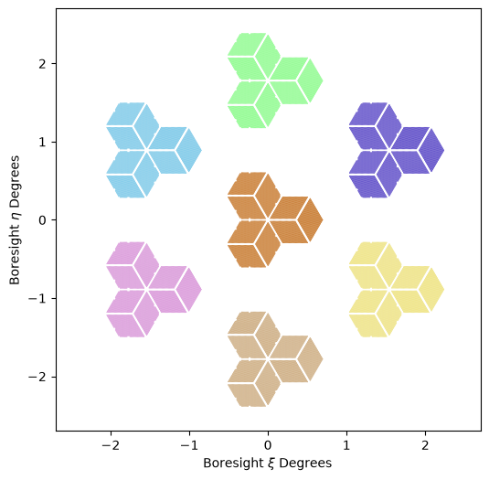

# Prime-Cam Focal Plane

Tools and bundled detector tables for constructing and visualizing the
Prime-Cam focal plane for the Fred Young Submillimeter Telescope (FYST). The
code builds configuration-driven, TOAST-compatible detector tables and places
individual Prime-Cam modules in the telescope boresight frame.

## Repository layout

| Path | Description |
| --- | --- |
| `src/primecam_focalplane/fp_primecam.py` | Builds detector tables from the YAML configuration. |
| `src/primecam_focalplane/module_to_boresight.py` | Converts module-relative detector quaternions to boresight-relative quaternions. |
| `src/primecam_focalplane/visualize_fp.py` | Plotting helper for TOAST `Focalplane` objects. |
| `src/primecam_focalplane/fp_files/fp_config.yaml` | Detector, wafer, module, and output settings. |
| `src/primecam_focalplane/fp_files/tables/` | HDF5 detector tables bundled with the package. |
| `tests/` | Pytest test suite. |
| `notebooks/` | Example workflows; not installed with the package. |
| `plots/` | Example output plots; not installed with the package. |

The configured module keys are `f280`, `f350`, `f420`, `f850`, `f_fake1`,
`f_fake2`, and `f_fake3`.

> **Note:** Only the `f280` noise parameters are currently set. The other
> modules are replicas of `f280` pending their final parameters.

## Requirements

The code requires Python 3.10 or newer and these runtime packages:

- NumPy
- Astropy
- PyYAML
- TOAST
- `fyst-trajectories`

Matplotlib is required for plotting. Pytest is required only for running the
test suite, and Jupyter is required only for the notebooks.

## Installation

From a local clone, install into the active Python or Conda environment:

```bash
python -m pip install .
```

Install a tagged version directly from GitHub:

```bash
python -m pip install \
    "git+https://github.com/Ankurdev-astro/primecam_focalplane.git@v0.1.0"
```

For an editable development installation with tests and plotting support:

```bash
python -m pip install -e ".[dev]"
```

Import through the package name:

```python
from primecam_focalplane.fp_primecam import PrimeCamFocalplane
from primecam_focalplane.module_to_boresight import ModuleToBoresightOffset
from primecam_focalplane.visualize_fp import plot_focalplane_primecam
```

## Build detector tables

Select one YAML module key with `--module`:

```bash
PYTHONPATH=src python -m primecam_focalplane.fp_primecam \
    src/primecam_focalplane/fp_files/fp_config.yaml \
    --module f280
```

Build every configured module in YAML order with:

```bash
PYTHONPATH=src python -m primecam_focalplane.fp_primecam \
    src/primecam_focalplane/fp_files/fp_config.yaml \
    --module all
```

With the supplied configuration, the files are written to
`src/primecam_focalplane/fp_files/tables/`. Each Astropy `QTable` is stored at
the HDF5 path `dettable_stack`. These tables are package resources and are
intended to be included in the wheel.

The output table contains detector identity and placement fields (`name`,
`quat`, `module`, `wafer_slot`, `band`, `pixel`, `pol`, and `index`) together
with polarization, beam, noise, band-center, and bandwidth metadata. Astropy
units are serialized with the table.

## Configuration

Each entry under `modules` in `fp_config.yaml` has three sections:

- `detector` defines the band, pixel layout, polarization pattern, beam,
  sampling rate, and noise properties.
- `module` defines the module geometry and its three wafer placements.
- `output` defines the output directory, filename, HDF5 table path, and
  overwrite behavior.

Relative output directories are resolved from the directory containing the
configuration file. The output filename may use `{name}`, which is replaced by
the configured `module.name`.

## Convert modules to the boresight frame

The bundled tables describe detectors relative to each module center.
`ModuleToBoresightOffset` loads a configured table, applies the module's static
Prime-Cam position, and returns a copy:

```python
from primecam_focalplane.module_to_boresight import ModuleToBoresightOffset

f280 = ModuleToBoresightOffset("primecam_f280")
f280_boresight = f280.apply()
```

In the returned table:

- `module_quat` preserves the original module-relative quaternion.
- `quat` contains the boresight-relative quaternion.

The current position assignments are defined in `MODULE_POSITIONS`. Module
clocking is currently assumed to be zero for every module and is recorded in
`MODULE_CLOCKING_DEG`. Update that mapping or pass `clocking_deg` to the
constructor when measured values are available.

To assemble all seven modules, convert each table and combine the results with
Astropy's `vstack`. The visualization notebook demonstrates this workflow.

## Visualize the focal plane

Pass a detector table to TOAST's `Focalplane`, then import the plotting helper:

```python
from primecam_focalplane.visualize_fp import plot_focalplane_primecam
```

Set `outfile=None` for an interactive Matplotlib window. Optional arguments can
show detector labels, pixel centers, polarization directions, and per-module
face colors. See `notebooks/visualize_fp_primecam.ipynb` for the complete
multi-module workflow.

Example full Prime-Cam focal-plane visualization:



## Run tests

Activate an environment containing the runtime dependencies and pytest, then
run from the repository root:

```bash
python -m pytest
```

The suite validates configuration parsing, focal-plane construction,
boresight conversion, and the presence and readability of every bundled HDF5
table.
